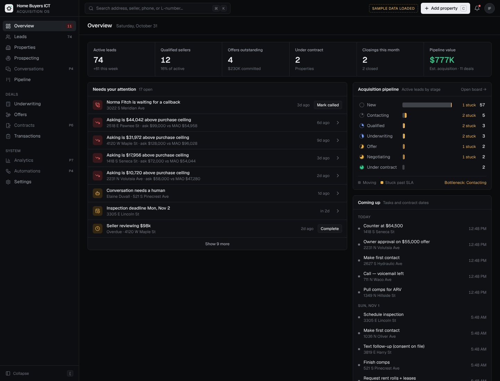

# Home Buyers ICT · Acquisition OS

Acquisition CRM + underwriting platform for Home Buyers ICT (Wichita, KS). BRRRR-first, owner-approved offers, PostgreSQL-backed, no GoHighLevel / Supabase / n8n.

**Status: Phase 2 (DealMachine integration) on top of the Phase 1 CRM foundation.** See [docs/DEALMACHINE.md](docs/DEALMACHINE.md). Not production-ready — see [docs/ARCHITECTURE.md](docs/ARCHITECTURE.md#production-readiness).



## Stack
Next.js 15 (App Router, server actions) · TypeScript · PostgreSQL 16 via Drizzle ORM · Tailwind with design tokens · Geist type · Lucide icons · Vitest + Playwright.

## Production hosting ($0/month)
Self-hosted on a free Oracle Cloud server with Docker: PostgreSQL, app, automatic HTTPS and nightly backups. Step-by-step: [docs/SELF_HOSTING.md](docs/SELF_HOSTING.md).

## Local setup
```bash
cp .env.example .env.local          # set DATABASE_URL
npm install
npm run db:migrate
npm run db:seed                     # labeled SAMPLE data; refuses to run in production
npm run dev                         # http://localhost:3000
```
Dev login: `owner@homebuyersict.test` / `acquisition-os-dev` (override with `SEED_OWNER_EMAIL` / `SEED_OWNER_PASSWORD`).

Create real users: `NEW_USER_PASSWORD='…' npm run user:create -- you@domain.com "Your Name" owner`

## Tests
```bash
npm test              # underwriting engine unit tests (Vitest)
npm run build && npm run test:e2e   # Playwright against a fresh acq_os_test database, also writes docs/screenshots
```

## Keyboard
`⌘K` search · `C` add property · `G` then `O/L/R/D/P/U/F/S` navigate · `J/K` + `↵` in tables · `[` sidebar · `?` all shortcuts

## Repo layout
```
src/app/(app)/        authenticated screens (dashboard, leads, properties, pipeline, …)
src/app/actions.ts    all mutations (zod-validated, role-checked, audited)
src/db/schema.ts      PostgreSQL schema; migrations in drizzle/
src/lib/underwriting/ deterministic BRRRR + flip engine and assumptions
src/lib/dealmachine/  API client, mapper, comps/ARV, webhook verification, credit guard, import service
src/components/       design-system primitives (ui/) and feature components
e2e/                  Playwright functional + screenshot suites, mock DealMachine server
legacy/               original single-file DealVelocity analyzer (reference only)
```
